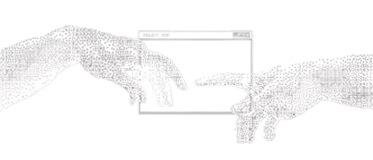

# Hi 👋, I'm ZINEDDINE

###  Web Developer & Designer

Design. Code. Details.

---

## 🚀 About Me

**ZINEDDINE**, a web developer and designer who likes building things that look good and work well. I care about the small details: spacing, typography, and how an interface feels to use.

I enjoy turning ideas into clean, simple websites. I usually start with the design, then bring it to life in code.

Currently, I'm learning **Design Engineering**, the space between design and code, while improving my skills through **building real projects and rebuilding designs I admire**.

My goal is simple: to build websites and products where every detail is designed to make an impact.

 

---

## 🤝 Connect

&nbsp;&nbsp;

&nbsp;&nbsp;

&nbsp;&nbsp;

---

## 💻 Tech Stack

